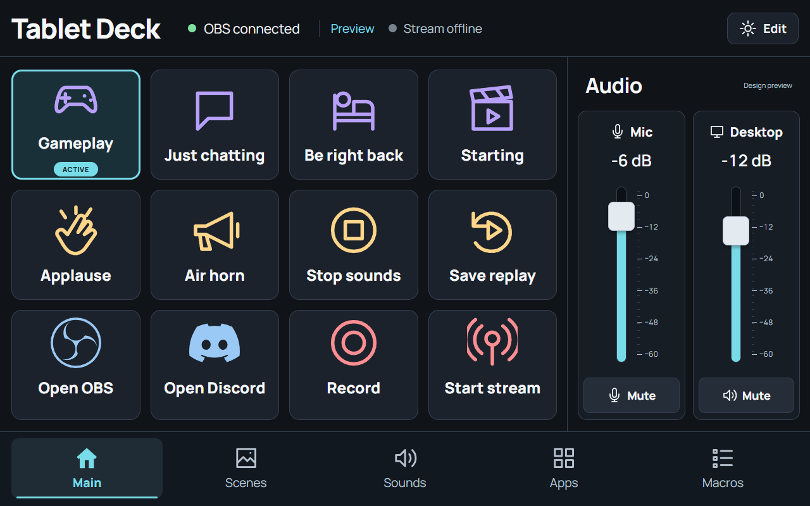

# Tablet Deck Studio

Turn an Android tablet into a customizable control board for a Windows streaming PC. Change OBS scenes, play sound effects, control audio, open apps, send hotkeys, and run macros over **Wi-Fi or USB**.

**[Download the latest release](https://github.com/tugcantopaloglu/tablet-deck-studio/releases/latest)** · [Build from source](docs/BUILDING.md) · [Verification results](docs/VERIFICATION.txt)



The Studio layout has twelve large buttons beside two audio faders and five page tabs. Version **1.5.0 adds Full pad mode with 24 or 40 buttons per group**, plus icon sizing that fits short rows, long labels, and active-scene badges. **1.5.1 fixes empty Soundpad library responses in the Windows companion**, so installed sounds appear in the tablet browser. Tap **Full pad**, choose a density, and use **Exit full pad** to restore the mixer. See the [full-pad guide](docs/FULL-PAD.md). The screenshot above is an illustrative Studio preview.

The low-latency transport and Android packaging fix from 1.4.1 are retained. Physical Android 16 tests verified USB/Wi-Fi connections, audible soundboard playback, real OBS scene changes and mic mute/unmute, and Discord playback-session mute with its original state restored. Sparse heartbeat samples were 3.9–10.5 ms over USB and 6.5 ms over Wi-Fi; these are not end-to-end latency guarantees. See the [performance guide](docs/PERFORMANCE.md) and [hardware test limits](docs/LIVE-TEST.md).

**1.6.0 adds running-action progress and cancellation.** A ribbon shows the current macro step and a **Cancel action** button in Studio and full-pad layouts. Cancellation interrupts delays and skips later steps; completed steps stay applied. See [running and cancelling macros](docs/MACROS.md) and the [development roadmap](docs/ROADMAP.md).

**1.7.0 adds board profiles, automatic backups, and Soundpad favourites.** Use **Profiles** in the bottom navigation to switch boards. The PC panel can create, duplicate, rename, or delete profiles and preview/restore the latest 20 backups. Star a sound in the Soundpad library, then choose **Favourites**. See the [complete profiles, backups, and favourites guide](docs/PROFILES-AND-BACKUPS.md).

**1.8.0 makes desktop setup easier.** Choose **PC setup** in the Windows control panel for tablet pairing, OBS connection and audio-input checks, button editing, profiles, backups, Soundpad, and Windows options. First-time PCs with no paired tablet open this guide automatically once per browser tab. OBS connection settings can be saved separately from board buttons, and checks never start a stream or play a sound. See [the PC setup guide](docs/PC-SETUP.md).

**1.9.0 adds all eight studio tools:** connection diagnostics, explicit OBS Start/Stop/Mute actions, recent Soundpad clips, an easier button editor with app/file selection and PNG icons, offline QR pairing, optional automatic profiles, an expanded OBS mixer, and portable board packs with selected audio. Choose **Tools** on the PC or tablet; local administration tools stay on the PC. Update both components. See [the complete Studio tools guide](docs/STUDIO-TOOLS.md).

**1.10.0 separates the Windows management console from the tablet board** and adds opt-in **OBS live preview and Twitch/Kick chat viewers**, with editable channel fields. The PC uses a sidebar and full-area editors; the tablet retains its action keys and optional monitor dock. Preview is a silent JPEG monitor at up to 4 fps, with independent OBS/control traffic. Android provider pages run in a separate view with no PC-control bridge. The update also fixes blocked Android script assets, improves LAN address selection and tablet/USB status, and includes a bounded Wi-Fi repair helper. See [monitoring and the desktop console](docs/MONITORING.md).

## Features

**1.13.0 correction:** Spotify and browser layouts now use a selected Windows media session with its real title, artwork when supplied, playback progress and supported transport/seek controls. Spotify commands target Spotify rather than the Windows global media player. Browser players need an explicit selection because Windows does not identify the website. Other app layouts use compact shortcut strips, with a relative frame jog for configured Resolve shortcuts. A **live Soundpad page** also brings the full library into the Memes pad itself, beyond the 24/40 keys visible in one group. See [targeted media controls](docs/MEDIA-CONTROLS.md), [Memes setup](#put-the-whole-soundpad-library-on-memes), and the [1.13 extension record](docs/UI-EXTENSION-1.13.md). The [v1.13.0 release](https://github.com/tugcantopaloglu/tablet-deck-studio/releases/tag/v1.13.0) is published; the final PC and matching code-16 APK installation were verified, with the media-test limits recorded below.

**1.12.0 introduced Computer Copilot**, a separate tablet mode for editable app shortcut layouts, plus optional viewing of an independent Windows display through an already-installed compatible SudoVDA driver. Choose **Computer Copilot** in the mode selector; use **Edit Copilot settings** in the Windows app to enable controls and edit layouts. Automatic following uses foreground executable names; browser tools use manual layouts. The initial shortcut-only media layouts are replaced by targeted media controls in the 1.13 correction above; other presets remain keyboard shortcuts, without deep application or AI integration. Display creation and tablet sharing require explicit PC consent; no driver is included or installed. The display view is a silent JPEG preview capped at 4 fps, with no touch forwarding. See [Computer Copilot](#computer-copilot), [controller details](docs/COMPUTER-COPILOT.md), [optional second display](docs/EXTENDED-DISPLAY.md), and the [1.12 UI extension record](docs/UI-EXTENSION-1.12.md).

**Live libraries:** an OBS scene page can now follow additions, renames, removals and scene order continuously while retaining its saved manual buttons behind a toggle. Soundpad's full library has Previous/Next and page selection in groups of 80, with automatic refresh every five seconds while open. The isolated pagination check visited all 1,421 fixture sounds; no third-party sound collection is bundled.

**1.11.0 adds a standalone Windows desktop window** with its own taskbar icon, resizing and close-to-tray behavior. Reopening the desktop shortcut or tray icon restores the same window. It also fixes the timer error that blocked desktop navigation, adds rendered click/native-window regression checks, and provides matching minimal application icons for Windows and Android (including adaptive/themed Android icons). The installer creates Desktop and Start menu shortcuts. The Windows app uses Microsoft's Evergreen WebView2 Runtime; if it is missing, the app shows an official download link. See [desktop setup](docs/PC-SETUP.md).

**In-app updates:** Windows options can check at app startup, download a verified Windows update and install/restart on confirmation. Optional USB APK updates support manual installation, automatic checks and a separate reopen setting. Android may require approval and briefly stops the app. Both components keep existing pairing. See the [complete update guide](docs/UPDATES.md).

| Area | Controls |
| --- | --- |
| Scenes | Live OBS scene page, switch program scene, set Studio Mode preview, take a transition |
| Audio | Two configurable OBS faders, input mute, Windows per-app playback volume/mute, PC soundboard with two synthesized demo effects |
| Broadcast | Streaming, recording, replay-buffer save, virtual camera, Studio Mode |
| Sources | Scene-source visibility, source-filter toggle, media restart/stop |
| Windows | App/shortcut launching, websites, keyboard shortcuts, volume/media keys |
| Soundpad | Live Memes pad from the full library, search/categories and page jump; separate 80-row library browser; favourites; mic/speakers/both output; selected-button import and transport |
| Discord and other tools | Matching app keybinds; Discord mute/deafen/screen-share setup documented |
| Macros | Multiple steps, delays, confirmation, live step progress, cancellation, stop on first error |
| Customization | Labels/icons/colors, ordering, multiple pages, up to 10 board profiles, current-profile JSON import/export, full-pad 24/40-button layouts |
| Backups | Latest 20 automatic snapshots, manual backup, restore preview and confirmation, damaged-config recovery, current credentials retained on restore |
| Connection | Persistent pinned TLS over Wi-Fi/USB, pushed state, HTTPS fallback, optional automatic USB reconnection |
| Desktop | Windows tray, opt-in startup, update notifications, per-user installer |
| Computer Copilot | Opt-in targeted Spotify/browser media controls, compact editable shortcut strips and relative Resolve jog, optional independent-display preview using an installed driver |
| Hold-to-talk | Renewable key-down/key-up shortcuts with a three-second disconnect lease |
| Voicemeeter | Native Strip/Bus gain and explicit mute/unmute through the installed remote DLL |

## Contents

- [Requirements](#requirements)
- [First run](#first-run)
- [Wi-Fi](#wi-fi)
- [USB](#usb)
- [Customize the board](#customize-the-board)
- [Computer Copilot](#computer-copilot)
- [Action reference](#action-reference)
- [Soundpad and Discord](#soundpad-and-discord)
- [Examples](#examples)
- [Backups and updates](#backups-and-updates)
- [Troubleshooting](#troubleshooting)
- [Data and security](#data-and-security)
- [Build and contribute](#build-and-contribute)

## Requirements

- Android 8.0 or newer, with an up-to-date Android System WebView / Chrome. Landscape tablet is the primary layout.
- Windows 10 version 2004 (build 19041) or newer, or Windows 11, x64 for the 1.13 source. The companion includes its .NET runtime; Node, Python, Android Studio, and .NET installation are not required to use it.
- For OBS controls: OBS Studio 28 or newer with WebSocket server enabled. Soundpad and other non-OBS actions also work with OBS closed.
- For Soundpad actions: Soundpad installed and running on the Windows PC under the same account as the companion.

## First run

For a managed Windows installation, download **TabletDeck-Setup.exe**, run it, and type `INSTALL` after reviewing its destination. It creates Desktop and Start menu shortcuts without launching any apps. The ZIP remains available for portable use. See [installation and uninstalling](docs/DESKTOP-AND-HOLD.md#install-or-update-windows).

Download the versioned complete ZIP for **1.13.0** from [Releases](https://github.com/tugcantopaloglu/tablet-deck-studio/releases/tag/v1.13.0), or download `TabletDeck-Studio.apk` separately if you only need the Android installer. Update both components. The APK keeps the original signing certificate, so installing it over an older version preserves pairing. Third-party meme collections are user content and are not included in the public release.

```text
TabletDeck-Studio/
├── TabletDeck-Studio.apk
├── SHA256SUMS.txt
├── Verification.txt
└── Windows/
    ├── TabletDeck-Companion.exe
    ├── Install-APK.cmd
    ├── USB-Connect.cmd
    ├── wwwroot/
    ├── Sounds/
    └── platform-tools/
```

1. Extract the whole ZIP. Keep the Windows folder together: the executable needs its wwwroot, Sounds, and platform-tools folders.
2. Run Windows/TabletDeck-Companion.exe on your streaming PC. It opens the native Windows console and stays in the Windows tray. Closing the window leaves it running; use the tray to reopen the same session or exit.
3. In OBS, open Tools → WebSocket Server Settings. Enable the server and keep authentication enabled. The usual port is 4455. Copy the server password.
4. In the Windows console, choose **OBS setup**, enter the port/password, and save. Use **Find inputs** for exact microphone/desktop names. Choose **Board editor → Import OBS scenes** to enable a continuously synced Scenes page. Existing manual buttons remain saved; turn off **Keep this page synced with live OBS** in the editor to restore them. Other example scene buttons need names matching OBS.
5. Install TabletDeck-Studio.apk on the tablet. You can copy the APK to the tablet and allow installation from that file source, or enable USB debugging and run Windows/Install-APK.cmd.
6. In the Windows sidebar choose **Tablet connections**, then follow either Wi-Fi or USB below. The desktop console configures the studio; action keys remain on the tablet.

For Soundpad or Discord-only use, skip the OBS setup steps. An OBS disconnected indicator is expected while OBS is closed; Soundpad, app launches, and keyboard shortcuts remain available.

The Android package has a personal signing certificate, not a Play Store identity. Windows binaries, including the installer, are unsigned and may trigger SmartScreen. The APK is signed with APK Signature Schemes v2 and v3. Verify the provided SHA256SUMS.txt if you transfer the files.

Installing by file manager: copy the APK to the tablet, open it, and allow that file source to install apps if Android prompts. Installing from Windows: authorize USB debugging, then run `Install-APK.cmd` with exactly one Android device connected.

OBS includes WebSocket support in version 28 and later. See the [official OBS remote-control guide](https://obsproject.com/kb/remote-control-guide). The tablet uses HTTPS port 8743 and persistent control port 8744; the companion reaches OBS locally, normally on port 4455. You do not normally need to expose OBS's port to the tablet.

## Wi-Fi

Connect the PC and tablet to the same private network. Avoid guest Wi-Fi, which often isolates devices. Allow the companion through Windows Firewall on the private network when Windows asks.

Update both components and allow the fast control port 8744 as described in the [performance guide](docs/PERFORMANCE.md). On the tablet select Wi-Fi, enter the PC address listed in Pair tablet, then enter the 24-character certificate code (hyphens and spaces are optional) and the six-digit PIN. The PIN expires in five minutes, is single-use, and locks after five wrong attempts. Generate a new PIN on the PC if it expires. The certificate code must match the intended PC before the tablet sends the PIN.

If Windows does not show a firewall prompt, allow TabletDeck-Companion.exe inbound on TCP ports 8743 and 8744 for the private network only. Do not forward this port on your router. No cloud account or subscription is needed.

## USB

USB uses an ADB reverse tunnel and works with Wi-Fi off. It is not USB tethering.

1. On Android, enable Developer options (usually tap Build number seven times), then enable USB debugging. Menu locations vary by manufacturer.
2. Connect a USB data cable, unlock the tablet, and approve the PC’s USB debugging authorization prompt. Some tablets need their manufacturer’s Windows USB driver.
3. Run Windows/USB-Connect.cmd. It creates the tablet-to-PC port tunnel. If no device is found, check authorization, cable, and driver. The included helper refuses to guess if multiple devices are attached; use USB-Connect.ps1 -Serial SERIAL in that case.
4. In the tablet’s connection screen select USB. Enter the same certificate code and a fresh pairing PIN from the Windows panel. A PC Wi-Fi address is optional for initial USB-only pairing.
5. Run USB-Connect.cmd again after unplugging the tablet or rebooting it, or enable **Windows options → Reconnect USB automatically**. Use the complete package, including platform-tools. The console distinguishes a saved pairing, an active fast link, and whether the app is installed over an authorized USB connection.

Once paired, tap the tablet’s connection status to switch between Wi-Fi and USB. If you initially paired only over USB, enter the PC’s Wi-Fi address before selecting Switch to Wi-Fi. The certificate and device credential are reused. Revoke a tablet through Pair tablet on the PC if it should lose access.

The helper creates the equivalent of this tunnel:

```powershell
# Run from the extracted Windows folder:
.\platform-tools\adb.exe -s YOUR_DEVICE_SERIAL reverse tcp:8743 tcp:8743
.\platform-tools\adb.exe -s YOUR_DEVICE_SERIAL reverse tcp:8744 tcp:8744
```

With multiple devices connected, select a serial explicitly:

```powershell
.\platform-tools\adb.exe devices
powershell.exe -NoProfile -ExecutionPolicy Bypass -File .\USB-Connect.ps1 -Serial YOUR_DEVICE_SERIAL
```

See Android's [ADB documentation](https://developer.android.com/tools/adb) and [Developer options guide](https://developer.android.com/studio/debug/dev-options) for device-specific debugging setup.

## Customize the board

Choose **Board editor** in the Windows sidebar. Select a page and button, then change its name, action, icon, and color. Add pages or buttons; drag a row by its handle to change order, or use Move earlier/later. Save changes to sync to the tablet. The Windows console does not render the tablet control grid. Adding actions and changing PC targets remain restricted to the local PC.

Enable **Keep this page synced with live OBS** for a page generated from the current OBS scene collection. Additions, renames, removals and order changes update the tablet without another import. Manual button editing and arrangement are hidden for that page while live sync is on; turn it off and save to restore the retained manual buttons. Reorder live scenes in OBS. A disconnected OBS shows an empty live-page explanation rather than stale scene controls.

On the tablet, choose **Edit → Arrange buttons**, drag keys to move them, then choose **Save order**. **Cancel** keeps the saved order. Actions do not run while arranging. On the PC, use the board editor’s ordering list instead. See [ordering, library, and volume instructions](docs/CONTROLS.md).

Actions:

- Switch OBS scene or set a Studio Mode preview scene; take the preview transition.
- Play WAV, MP3, or WMA on the PC; stop all sounds started by the deck. Two original synthesized demo sounds are included.
- Launch an existing Windows .exe or .lnk using an absolute path, or open an HTTP/HTTPS website. There is no arbitrary remote shell command facility.
- Send hotkeys such as CTRL+SHIFT+M, ALT+TAB, F13, PLAYPAUSE, NEXTTRACK, PREVTRACK, VOLUMEUP, VOLUMEDOWN, or VOLUMEMUTE. Keyboard shortcuts reach the foreground application or a configured global keybind in a running app; Windows can block injection into elevated apps.
- Mute an OBS input; toggle a scene source or source filter; restart or stop an OBS media input.
- Toggle recording, streaming, Studio Mode, or the virtual camera; save an enabled OBS replay buffer. Streaming and recording always ask for confirmation, including inside macros.
- Run multiple steps in sequence. Each macro step has an action, target, and optional source/filter/media value. Delay steps use milliseconds (0–10000). Steps stop at the first error. Execution has a 45-second budget; changes already made are not rolled back.

The audio faders adjust the two configured OBS inputs from -60 to 0 dB. **App volumes** opens separate Windows playback-session volume and mute controls. Start playback in an app if it is missing, then refresh. These controls change Windows Volume Mixer settings and may affect what OBS or Discord captures from that app. They do not set microphone gain. Mute is neutral; muted channels show red Unmute. PC/OBS loss clears ACTIVE scene state and shows Stream unknown.

For sound effects to reach viewers, capture the PC’s playback output in OBS Desktop Audio, application audio capture, or your virtual mixer. Sound playback alone does not inject audio into the microphone. The deck’s Stop sounds button only stops deck playback. Restart/stop OBS media actions target media sources separately.

Record and replay controls require those features to be configured in OBS. An unconfigured replay buffer or invalid scene/source/input returns the OBS error on the tablet. Defaults are examples, not a claim about your PC’s current setup. OBS and Discord launch paths can be adjusted in Edit; Discord is detected on first run when installed in its usual user folder.

Export/Import saves the current profile's board JSON without the OBS password, inactive profiles, or favourites. Import replaces only the current profile after review and Save changes; imported page/button identities are regenerated. Sound files and applications are referenced by absolute PC paths; they are not copied into an export. The app does not include Elgato’s proprietary plugin marketplace or automatic support for every third-party plugin.

## Computer Copilot

1. In the Windows console's mode selector, choose **Computer Copilot**, then **Edit Copilot settings**.
2. Enable **Computer Copilot**; it starts off. Edit layout names, associated `.exe` names, control labels/groups, and shortcuts, or add a tool layout. Save on the PC to sync to the tablet.
3. On the tablet, choose **Computer Copilot** in its mode selector. Supplied layouts include Desktop, YouTube, Spotify, Codex / GitHub Copilot, Claude, DaVinci Resolve, and Photoshop.
4. **Follow supported foreground apps** automatically chooses a uniquely matching executable. Selecting a layout on the tablet switches to manual selection; enable following again in PC settings. Browser tabs/websites are not inspected, so choose YouTube or Claude manually. Selecting a layout never opens or focuses the app.

For **Spotify**, start media in the Spotify desktop app, then choose its player in **Playback target** if prompted. The surface shows the actual track title, artist/album information, artwork when available, elapsed/total time, and supported Previous/Play/Pause/Next/seek controls. These commands address that Spotify session; they do not fall back to YouTube or another player when Spotify is missing. The selected player must advertise the relevant capability.

For **YouTube**, select the intended browser title/source in **Playback target**. Windows reports a browser player, not its URL or website, so this layout cannot prove it is YouTube. The seek slider sends a final position for the track you began dragging; a changed track or replaced session rejects stale input. **Spotify volume** controls an exact matching app output. **Browser volume (all tabs)** affects the browser's application output, including other tabs; choose an audio output if several match. It never silently substitutes system volume.

If another Windows player cannot provide its details, a warning can appear while the valid selected player remains usable. A full media-read failure instead clears unavailable controls and asks you to refresh.

Other layouts remain configurable shortcuts that require the matching foreground app, presented in compact context strips. Resolve's **Frame jog** repeats the configured previous/next frame shortcuts while dragged and returns to center on release; it does not read Resolve's native playhead or provide an absolute timeline position. Desktop global media/app-switch controls retain their global meaning. Assistant-panel entries begin unassigned so you can match your local keymap; Computer Copilot has no default Send command and rejects Enter-containing shortcuts. It does not read chats or send prompts. Windows focus and input-permission limits still apply. See the [controller contract](docs/COMPUTER-COPILOT.md) and [targeted media details](docs/MEDIA-CONTROLS.md).

For an optional separate desktop, expand **Second display** on the PC, review the already-installed compatible SudoVDA driver's trust information, and explicitly accept both driver use and sharing its pixels with the paired tablet before **Create independent display** becomes available. Choose a supported resolution; if needed, set that monitor to **Extend** in Windows Display settings. Then use **Open display view** on the tablet. **Back to controls**, **Pause tablet sharing**, and **Remove extra display** stop the corresponding viewing/sharing/session activity.

No virtual display driver is bundled, downloaded, or installed. The view sends only that session's independent monitor, up to 4 JPEG frames per second with no audio. Touch/mouse forwarding and full-motion remote-desktop performance are not provided. The driver needs its own trusted installation; contextual shortcuts work without it. See [requirements, limits, and verification](docs/EXTENDED-DISPLAY.md).

## Action reference

Scene, input, source, and filter names must match OBS exactly.

| Action | Target | Additional field or prerequisite |
| --- | --- | --- |
| Switch OBS scene | Scene name | None |
| Set preview scene | Scene name | Studio Mode enabled |
| Take studio transition | None | Studio Mode and a preview scene |
| Play sound on PC | Absolute WAV/MP3/WMA path | Capture playback output in OBS |
| Stop all deck sounds | None | Stops deck playback only |
| Open Windows app | Absolute .exe or .lnk path | File must exist |
| Open website | HTTP/HTTPS URL | Opens the PC browser |
| Send keyboard shortcut | For example CTRL+SHIFT+M | Foreground app receives the keys |
| Toggle OBS input mute | Input name | Input must exist |
| Toggle source visibility | Scene name | Source name in that scene |
| Toggle source filter | Source name | Filter name |
| Restart / stop OBS media | Media input name | restart or stop |
| Toggle recording / streaming | None | Configure OBS first; confirmation required |
| Save replay buffer | None | Configure and start the replay buffer in OBS |
| Toggle virtual camera / Studio Mode | None | Feature must be available in OBS |
| Run multiple actions | Steps in the editor | Executes in order |
| Delay | Milliseconds, 0–10000 | Usually a macro step |
| Soundpad · play sound | Positive index from All sounds | Output: mic, speakers, both, or default |
| Soundpad · stop / pause / next / previous | None | Keep Soundpad running |

Supported shortcuts include letters, digits, F1–F24, CTRL, SHIFT, ALT, WIN, ENTER, TAB, ESC, SPACE, BACKSPACE, DELETE, arrow keys, and the volume/media keys listed above. Join simultaneous keys with +.

## Soundpad and Discord

Yes, the board can be used with **Discord desktop streams and calls**, as well as OBS. See the detailed [integration guide](docs/INTEGRATIONS.md).

**Soundpad:** keep it running on the PC, then choose **Soundpad** in the board toolbar to browse names and categories. Select a playback output and press **Play**. In the PC library, select sounds and choose **Add selected buttons** to put them on a page. You can also add a **Soundpad · play sound** action manually by its All sounds index. Use output **mic** to send an effect through Soundpad's configured microphone, **both** to hear it locally as well, or **speakers** for local-only playback. Dedicated stop, pause/resume, next, and previous controls do not need keyboard focus or an executable path.

Use **Previous**, **Next**, or **Sound page** to reach the whole matching library, 80 sounds per page. Search and category changes return to the first page. The open, visible library refreshes every five seconds, retaining selection by sound identity where possible; it does not play anything automatically. A 1,421-sound library spans 18 pages, including a final page of 61 sounds.

### Put the whole Soundpad library on Memes

1. In the Windows sidebar choose **Board editor**. Select **Memes** in the editor's page dropdown, or add a page with that name in the current profile.
2. Enable **Use the full live Soundpad library on this page**. Choose **Soundpad playback output**: **Discord / microphone**, **Speakers and microphone**, or **Speakers only**. Save changes.
3. On the tablet stay in **Stream Studio** and choose the **Memes** page. Use **Search all Soundpad sounds**, **Soundpad category**, and **Jump to sound page** or the group navigation to reach every loaded sound. Full pad's 24/40 setting controls how many keys fit at once, not how many sounds exist.

The development source library contains 1,421 entries; live pages support up to 5,000. You do not need thousands of saved buttons, duplicate imports, or multiple profiles. One page per profile can follow Soundpad; enabling another transfers live mode to that page. The pad refreshes about every five seconds while active. Existing manual Memes buttons remain saved and return if you disable live Soundpad and save. Live OBS and live Soundpad cannot both supply the same page. Soundpad must stay running; an unavailable source shows recovery guidance. Microphone output still depends on Soundpad's configured mic and the receiving app's audio settings.

**Discord controls:** configure Toggle Mute, Toggle Deafen, or Toggle Screen Share in Discord's desktop **User Settings → Keybinds**, then create matching **Send keyboard shortcut** buttons here. Leave Discord's keybind editor before testing. The share picker or stream settings may still need confirmation in Discord. These are shortcut controls, not live Discord-state indicators. The board's Start stream button controls OBS, not Discord.

**Discord audio:** select the same microphone in Soundpad and Discord. If effects are filtered, follow [Soundpad's Discord FAQ](https://www.leppsoft.com/soundpad/help/faq). Normal PC playback alone does not send audio into Discord's microphone. Application-share audio and voice audio are separate paths; avoid capturing the same effect twice.

**Other stream tools:** use a tool's supported global keybinds, foreground shortcuts, app launches, or macros. There is no automatic integration with every tool or plugin. The ordinary shortcut action sends a tap. For push to talk, use the separate **Hold keyboard shortcut / push to talk** action with a matching app binding; see the [hold guide](docs/DESKTOP-AND-HOLD.md#hold-to-talk-buttons).

## Examples

### Open an application

In the PC editor, add a button, choose **Open Windows app**, and enter the full path to an executable, such as `C:\Program Files\obs-studio\bin\64bit\obs64.exe`.

Choose a label, icon, and color, then **Save changes**. Use a Windows shortcut for a specific launch configuration; command-line arguments are not a separate button field.

### Add your own sound

Choose **Play sound on PC** and set Target to an existing file, for example `C:\StreamSounds\applause.wav`.

The companion plays the file through the PC's default output. Check that output's meter in OBS and listen to a short test recording. If you use a virtual mixer, route that playback output into the stream mix. The sound is not played by the tablet or injected into the microphone automatically.

### Make a scene-and-sound macro

1. Choose the Macros page in Edit and select **Add button**.
2. Name it **Scene + sting**, then choose **Run multiple actions**.
3. Add a **Switch OBS scene** step, targeting an actual scene such as Gameplay.
4. Add a **Delay** step with Target 300.
5. Add a **Play sound on PC** step with the absolute path to your transition sound.
6. Save and test it offline.

Macros support up to 30 steps. They stop at the first error and have a 45-second execution budget. Earlier steps are not rolled back. A stream or recording step causes the macro to require confirmation. A toggle reverses the current state, so avoid adding toggles unless that reversal is intended.

While an action runs, the bottom ribbon shows its label and current step, including steps inside nested macros. Choose **Cancel action** to interrupt a delay and prevent later steps. A command already sent to OBS or Windows may finish first. Cancellation does not undo earlier scene changes, close opened apps, stop an already started broadcast, or stop sound playback. Use the relevant controls afterward. Any paired controller can cancel the displayed run; stale cancellation requests cannot cancel a newer run.

### Read the board's state

A cyan outline and ACTIVE label mark the current OBS scene. Muted channels show red Unmute buttons. Buttons can show Set up on PC when their file/app/shortcut target is missing. After a connection failure, Stream unknown means the companion cannot confirm OBS's state; it does not mean OBS stopped broadcasting. Use Mute for a muted input rather than relying on the fader's −60 dB minimum.

## Backups and updates

Choose **Profiles** in the bottom navigation to switch boards on either PC or tablet. On PC, create an empty profile or duplicate the current board, then switch when ready. OBS credentials, mixer input names, tablet pairing, and favourites are shared. Switching or editing profiles is blocked during a running macro; held shortcuts are released server-side when a board change is applied. See [profiles and recovery](docs/PROFILES-AND-BACKUPS.md).

Automatic backups keep the latest **20 snapshots** before board edits, profile changes, favourite changes, and restores. Profile switching and unchanged saves do not consume history. On PC choose **Profiles → Backups and restore** for a manual snapshot or a preview of all profiles in a backup. Restore requires confirmation and keeps the current OBS password, certificate, and pairing. Backups contain board targets and paths but no OBS password or tablet credentials; sound files and apps are not copied. A damaged main config is retained privately, and the newest valid snapshot is recovered; re-enter the OBS password after this exceptional recovery.

Use **Edit → Export** to download the current profile's board without the OBS password. Use **Import**, review the result, then **Save changes** to apply it to that profile. Exported boards reference absolute sound and app paths; transfer those files separately when moving PCs.

For a Windows update, exit the companion through its tray menu, extract the full new package, and keep its executable, wwwroot, Sounds, and helpers together. Settings remain in `%LOCALAPPDATA%\TabletDeck`. If saved sound buttons point inside an old release folder, update those paths after moving the package.

An APK signed with the same key can update the existing installation. Install-APK.cmd uses adb install -r. A differently signed APK requires uninstalling the old app, which clears its saved pairing.

To remove access, use **Revoke** in the PC's Pair tablet panel. To clear the tablet's connection, use **Forget this PC**. The companion installs no service or startup task: close it and remove its extracted folder to remove the program. Delete its local-data directory only when you also intend to erase settings, paired-device records, and the certificate.

## Troubleshooting

| Problem | What to check |
| --- | --- |
| PC disconnected over Wi-Fi | Companion running, correct local PC address, private-network TCP 8743/8744 allowed, no guest/client isolation |
| OBS disconnected | OBS running, WebSocket enabled, correct companion port/password; normally port 4455 |
| Pairing PIN rejected | Generate a fresh PIN; it is single-use, expires after five minutes, and locks after five wrong attempts |
| Certificate mismatch | Use the certificate code from the intended PC's current companion; deleting its data changes its identity |
| Invalid scene or source | Match names for manual actions; Import OBS scenes enables the live Scenes page, while Main/manual buttons stay separate |
| Fader needs setup | Use Edit → Find OBS inputs and configure exact Mic/Desktop input names |
| Sound heard locally but not on stream | Capture playback output in OBS; check virtual-mixer routing and make a test recording |
| App/sound says Set up on PC | Choose an existing absolute file path in Edit |
| Hotkey does nothing | Focus the intended app and check its shortcut; Windows may block injection into elevated apps |
| Soundpad library unavailable | Keep Soundpad running under the same account; use Refresh library after changing its sounds |
| Wrong Soundpad sound after reordering | Indices follow All sounds; refresh the library and update existing button indices |
| App missing from volumes | Start audio playback, then Refresh apps; each output/session can have its own row |
| App volume reports session ended | Refresh apps after restarting the app or changing output device |
| Save replay fails | Configure and start OBS's replay buffer first |
| No authorized Android device | Data cable, USB debugging, unlocked tablet, PC authorization, manufacturer USB driver if required |
| ADB shows unauthorized | Approve the USB-debugging prompt on the tablet |
| Multiple USB devices | Run USB-Connect.ps1 with the intended device serial |
| USB stopped after reconnect | Run USB-Connect.cmd again to recreate the reverse tunnel |
| Editor tab was closed | Close and restart the companion to reopen an authenticated tab |
| Already running / port in use | Close the existing companion or the process using port 8740/8743 |
| APK will not install | Android 8.0+, permission to install from that file source, matching signing key for an update |
| Layout misbehaves on an older tablet | Update Android System WebView / Chrome, then repeat the rehearsal |

When reporting an issue, include Windows/Android/OBS versions, connection mode, exact error text, and reproduction steps. Do not post OBS passwords, pairing codes, credentials, private keys, or the runtime data directory.

## Data and security

The PC editor is bound to loopback port 8740 and requires a random local session credential. Remote tablet control uses TLS on port 8743, the PC certificate is pinned by the Android app, and each paired tablet gets a separately revocable random credential. Server-side device credentials are stored as SHA-256 hashes. The initial certificate code is a 96-bit SHA-256 prefix; after pairing the full certificate fingerprint is pinned. No certificates are installed into the system trust store.

Settings, the OBS password, certificate private key, and device records live under %LOCALAPPDATA%/TabletDeck, protected by a directory ACL for the current Windows user and SYSTEM. The OBS password and PFX are not application-encrypted at rest; users with access to the account can read them. Android credentials are in app-private storage and Android backups are disabled. The app’s WebView loads only bundled assets, blocks external navigation and frames, sanitizes dynamic markup, and permits only the required control endpoints through its native bridge.

If you close the Windows console, the companion keeps running. Choose **Open Tablet Deck Studio** in the tray menu to restore its authenticated session. It does not install a service. Startup is opt-in through Windows options and uses the current account Run entry. Automatic USB reconnection, APK updating, and APK reopening also default off; existing saved choices are retained on update.

## Verification and limits

See [Verification results](docs/VERIFICATION.txt) for the final **1,173 checks**, build and security results, and [the hardware report](docs/LIVE-TEST.md) for physical USB/Wi-Fi, OBS, and Soundpad evidence. The [1.11](docs/UI-EXTENSION-1.11.md), [1.12](docs/UI-EXTENSION-1.12.md), and [1.13](docs/UI-EXTENSION-1.13.md) UI records distinguish rendered fixtures from actual native/hardware checks. The final PC build and published code-16 APK were installed and verified; the live Memes pad matched all 1,421 source entries while preserving its 76 manual buttons and output preference. Real Chrome metadata and a valid partial-warning response were read successfully; Spotify had no session, and the user skipped live playback testing. Fake-player tests therefore remain the evidence for media writes. The new live-Memes UI test uses 2,007 fixture entries without real audio. A controlled real-driver check created and removed a 1280 × 800 independent monitor with sharing off and left both physical monitors unchanged. Actual pixel capture/delivery, display-view latency, physical `FLAG_SECURE` appearance, and touch interaction remain unverified. Run a rehearsal before relying on it in a broadcast.

## Build and contribute

See [BUILDING.md](docs/BUILDING.md) for building the Windows companion and Android APK, signing-key handling, assembling a distribution, and running the isolated integration tests. Private release signing keys are deliberately excluded from this repository.

The Windows source targets `net10.0-windows10.0.19041.0` and pins `WindowsSdkPackageVersion` to `10.0.19041.57` for media-session APIs. The SDK reference package is restored during the source build; it is not an extra end-user installation requirement. The source identity is 1.13.0, with Android version code 16.

```text
android/                 Manifest, resources, and Java HTTPS bridge
companion/               C# ASP.NET Core companion
companion/wwwroot/       Shared HTML, CSS, JavaScript, fonts, DOMPurify
companion/ComputerCopilot.cs  Contextual shortcut settings and dispatch guards
companion/ExtendedDisplay.cs  Optional installed-driver session and JPEG capture
companion/MediaSessions.cs  Selected Windows player metadata and transport
companion/LiveSoundpad.cs  Runtime Soundpad pad entries without bulk saved buttons
companion/Sounds/        Synthesized demo WAV files
scripts/                 APK build and Windows USB/install helpers
installer/               Per-user Windows setup executable source
tests/                   Mock OBS service and browser/API checks
docs/                    Build guide, screenshot, and verification
```

For changes, fork the repository, create a branch, run the relevant checks, and open a pull request describing the behavior and how it was verified. Keep hardware-test claims separate from browser and mock-OBS checks.

## Third-party notices

Manrope is distributed under the [SIL Open Font License](companion/wwwroot/fonts/OFL.txt). DOMPurify is vendored with its [license](companion/wwwroot/vendor/DOMPurify-LICENSE.txt). Windows audio-session access uses [NAudio under the MIT license](companion/Licenses/NAudio.txt). OBS and Discord vector marks are from [Simple Icons under CC0](companion/wwwroot/vendor/Simple-Icons-CC0.txt); trademarks belong to their owners. Release packages retain Android platform-tools and Microsoft .NET notices.

Windows media references retain the [Windows SDK terms](companion/Licenses/WINDOWS-SDK-LICENSE.rtf) and [CsWinRT MIT license](companion/Licenses/CSWINRT-LICENSE.txt).

No project-wide open-source license has been assigned. Public visibility does not replace the licenses of the third-party components above. This project is not affiliated with or endorsed by Elgato, OBS, Discord, Google, or Microsoft.
